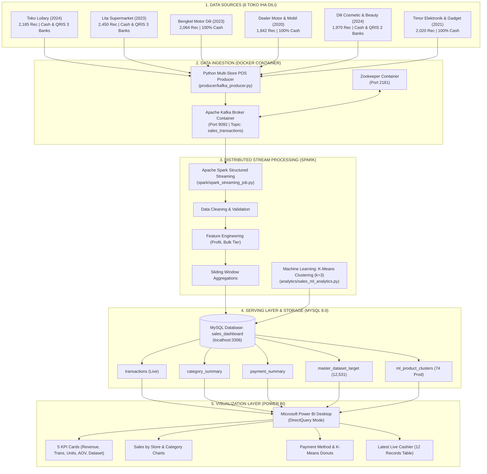
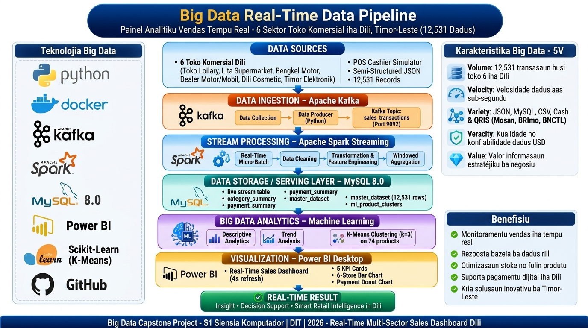
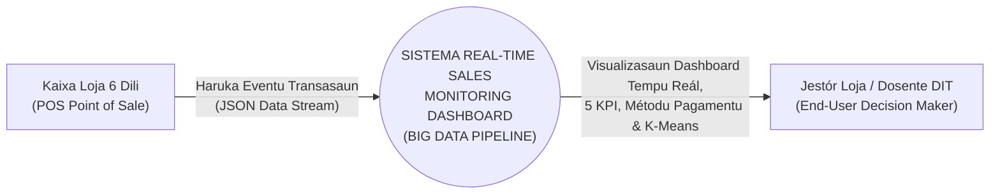
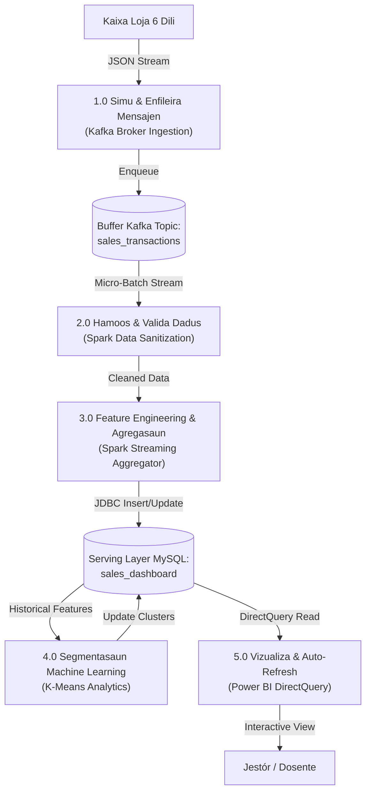
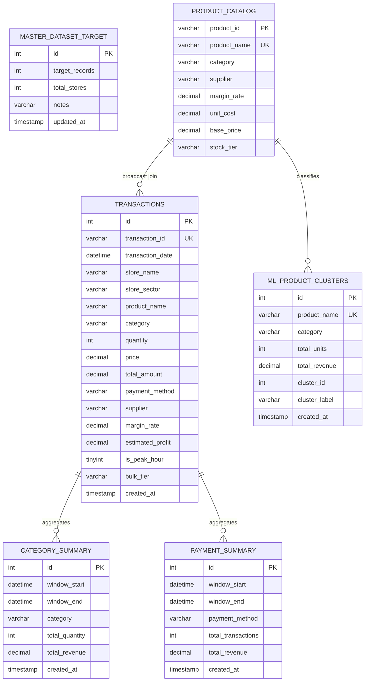
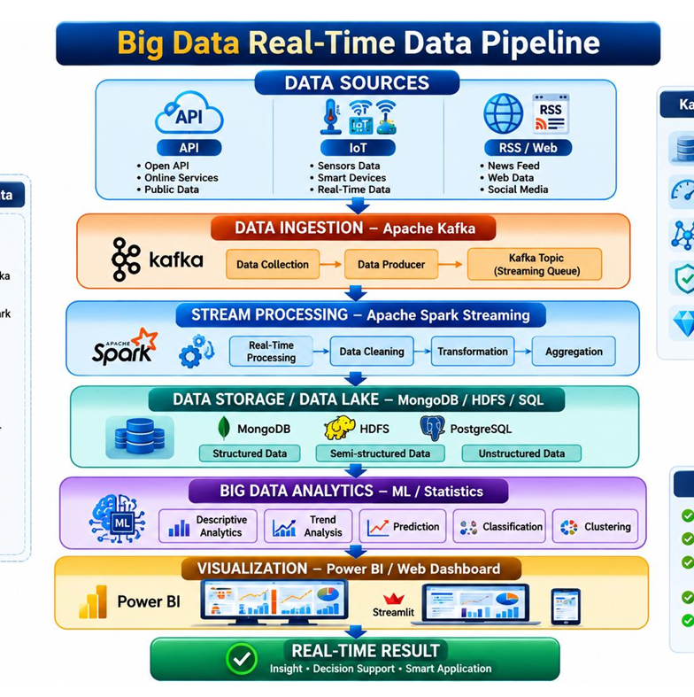

# PROPOSTA CAPSTONE PROJECT
## UNIDADE KURIKULER: SISTEMA BIG DATA & ANALYTICS
### ACADEMIC YEAR 2026 – DEPARTAMENTU SIÉNSIA KOMPUTADÓR

---

# SISTEMA REAL-TIME SALES MONITORING DASHBOARD BA SEKTOR KOMERSIÁL 6 IHA DILI BAZEIA BA BIG DATA STREAMING PIPELINE

**Proposta Projetu Capstone aprezenta ba:**  
Departamentu Siénsia Komputadór  
Fakuldade Siénsia no Enjeñaria  
**Dili Institute of Technology (DIT)**  
*“Matenek Nodi Serbii”*  
Dili, Timor-Leste

---

### **GRUPO DEZENVOLVEDÓR / ESTUDANTE:**
1. **Osvaldo A. da C. Fernandes** (Líder Tékniku & Data Engineer)
2. **Minguel F.E Leltacaeb** (Stream Processing & Spark Engineer)
3. **Deonildo Victor Tahu** (Database & Serving Layer Specialist)
4. **Lourenco M. Ximenes** (Data Analytics & Power BI Designer)

---

## ESTRUTURA PROPOSTA (TABELA KONTEÚDU)

* **KAPÍTULU 1 – INTRODUSAUN**
  * 1.1 Background
  * 1.2 Problem Statement
  * 1.3 Research Questions
  * 1.4 Project Objectives
  * 1.5 Project Scope
  * 1.6 Benefit
* **KAPÍTULU 2 – LITERATURE REVIEW**
  * 2.1 Big Data & Konseitu 5V
  * 2.2 Data Streaming vs Batch Processing
  * 2.3 Apache Kafka (Message Broker Distribuídu)
  * 2.4 Apache Spark (Stream & Batch Engine)
  * 2.5 Data Analytics & Machine Learning
  * 2.6 Related Projects & Estudu Relevante
* **KAPÍTULU 3 – METODOLOJIA**
  * 3.1 Data Source (Peskiza Kampu Toko 6 iha Dili)
  * 3.2 Data Collection & Schema JSON
  * 3.3 Data Ingestion (Apache Kafka Broker)
  * 3.4 Data Storage (Serving Layer MySQL 8.0)
  * 3.5 Data Processing (Apache Spark Structured Streaming)
  * 3.6 Data Analytics (K-Means Clustering k=3)
  * 3.7 Visualization (Microsoft Power BI Desktop DirectQuery)
* **KAPÍTULU 4 – DEZENHU SISTEMA**
  * 4.1 System Architecture (Arkitetura Pipeline Kompletu)
  * 4.2 Data Flow Diagram (DFD Level 0 & Level 1)
  * 4.3 Database Design (Disionáriu Dadus & Schema Tabela Kompletu)
  * 4.4 Processing Pipeline (Kafka -> Spark -> MySQL)
  * 4.5 Dashboard Design (Layout Vizualizasaun & Power BI)
* **KAPÍTULU 5 – REZULTADU ESPETATIVAS**
  * 5.1 Deskrisaun Rezultadu ne'ebé Estudante Espera atu Hetan
* **REFERÉNSIA BIBLIOGRÁFIKA**

---

# KAPÍTULU 1 – INTRODUSAUN

### 1.1 Background
Iha era transformasaun dijitál ohin loron, movimentu komersiál no transasaun fa'an sasán iha sidade Dili, Timor-Leste, hatudu kresimentu ne'ebé signifikativu tebes. Hahú husi supermerkadu modernu, loja sembako retallu, bengkel servis veíkulu, dealer motor no karreta, to'o loja kosmétika no eletrónika, kada estabelesimentu komersiál hasoru operasaun kaixa (Point-of-Sale / POS) ne'ebé jera dadus transasaun ho volume no velosidade ne'ebé aas.

Maske nune'e, maioria emprezáriu no jestór loja sira iha Dili sei hasoru dezafiu boot iha monitorizasaun vendas. Prátika ne'ebé baibain uza mak jestaun manuál ka relatóriu *batch* tradisionál iha ne'ebé dadus transasaun foin bele analiza bainhira loja taka ona iha kalan ka iha loron tuirmai. Kondisaun ne'e hamosu atrasu informasaun (*information latency*) ne'ebé impede jestór sira atu foti desizaun estratéjiku iha tempu reál (*real-time decision making*), hanesan deteta produtu ne'ebé fa'an lais liu (*fast-moving items*), identifika kategoria ne'ebé fó lukru boot, no halo rekonsiliasaun osan tama tuir métodu pagamentu ne'ebé kliente uza.

Alende ne'e, ekosistema pagamentu iha Timor-Leste mós tama daudaun iha faze tranzisaun. Maski pagamentu uza osan-rahun fíziku (Cash USD) sei domina tebes iha setor pezas no veíkulu, krensa no adosaun ba pagamentu dijitál QRIS (hanesan Mosan husi Telemor, BNCTL Quick, no BRImo) komesa buras maka'as iha supermerkadu no loja kosmétika. Mudansa komportamentu konsumidór ida-ne'e presiza plataforma teknolojia ne'ebé bele simu, hamoos, agrega, no vizualiza fluxu dadus komersiál multi-setor ho lalais, akuradu, no seguru.

Hodi responde ba nesesidade ne'e, grupu estudante dezenvolve projetu Capstone ho títulu **"Real-Time Sales Monitoring Dashboard"** ne'ebé bazeia ba arkitetura Big Data moderna. Sistema ne'e integra teknolojia industria nivel aas: **Docker** ba jestaun kontentorizasaun servisu, **Apache Kafka** nu'udar distributed message broker ba *data ingestion*, **Apache Spark Streaming** ba prosesamentu distribuídu tempu reál, **MySQL 8.0** nu'udar *Serving/Speed Layer* ho integridade transasionál ACID, algoritmu **Machine Learning K-Means Clustering ($k=3$)** ba segmentasaun produtu, no **Microsoft Power BI Desktop** ho ligasaun *DirectQuery* ba vizualizasaun interativa ho auto-refresh.

---

### 1.2 Problem Statement
Problema prinsipál sira ne'ebé identifika liuhusi peskiza kampu iha loja 6 iha sidade Dili mak:
1. **Atrasu Relatóriu Vendas (High Data Latency):** Jestór loja sira la iha asesu ba painel kontrolu tempu reál. Relatóriu fa'an loron nian depende ba verifikasaun manuál ka eksportasaun spreadsheet ne'ebé demora oras barak, hodi hamosu risku stoke mamuk (*stockouts*) ka stoke resin.
2. **Kompleksidade Métodu Pagamentu Multi-Setor:** Kada setor komersiál iha Dili iha karakterístika pagamentu ne'ebé diferente: setor bengkel no dealer depende 100% ba Cash, enkuantu supermerkadu no kosmétika simu Cash no QRIS (Mosan, BRImo, BNCTL). La iha sistema sentralizadu ne'ebé bele monitoriza proporsaun pagamentu dijitál hasoru cash instantaneamente.
3. **Limitasaun Arkivasaun Tradisionál ba Big Data:** Baze dadus relacionál konvensionál hasoru kualker bottleneck bainhira simu fluxu transasaun kontínuu husi POS barak iha tempu hanesan (*peak shopping hours*). Se la uza buffer distribuídu hanesan Kafka, sistema bele hetan *data loss* ka *connection timeout*.
4. **Kuantidade Produtu ne'ebé Barak la Hetan Segmentasaun Matenek:** Jestór sira susar atu determina produtu ida-ne'ebé mak fó kontribuisaun reseita boot (*high revenue driver*) hasoru produtu ne'ebé rotasaun lais maibé marjen ki'ik, tanba la iha analítika Machine Learning ne'ebé klasifika perfil produtu sira-ne'e automatikamente.

---

### 1.3 Research Questions
1. Oinsá dezenha no implementa pipeline Big Data Streaming distribuídu hodi halo *data ingestion* ho velosidade sub-segundu husi loja komersiál 6 iha Dili uza Apache Kafka?
2. Oinsá utiliza Apache Spark Structured Streaming hodi ezekuta *data cleaning*, *sliding window aggregation*, no *feature engineering* (profit estimadu, margin rate, bulk tier) iha tempu reál?
3. Oinsá dezenha baze dadus MySQL 8.0 nu'udar *Serving Layer* ne'ebé garante konsisténsia dadus ACID no fornese resposta query rápidu ba ferramenta vizualizasaun?
4. Oinsá aplikasaun algoritmu Machine Learning K-Means Clustering ($k=3$) bele halo segmentasaun lójika ba produtu 74 komersiál bazeia ba volume fa'an, reseita, frekuénsia pedidu, no presu médiu?
5. Oinsá dezenha painel interativu iha Microsoft Power BI Desktop ho ligasaun DirectQuery ne'ebé hatudu 5 KPI prinsipal, grafiku kategoria, donut pagamentu, grafiku lojas 6, no tabela live cashier?

---

### 1.4 Project Objectives
1. **Rekolha Dadus Peskiza Kampu:** Foti dadus riil 12.531 transasaun istóriku no katalogu produtu 74 husi loja komersiál 6 iha Dili ho períodu operasaun husi tinan 2020 to'o 2026.
2. **Dezenvolve Pipeline Data Ingestion:** Konfigura kontentor Docker ba Zookeeper no Apache Kafka Broker 7.5.0 hodi simu fluxu payload JSON husi simulador POS kaixa uza tópiku `sales_transactions`.
3. **Implementa Stream Processing Distribuídu:** Uza Apache Spark 3.5.0 hodi lee mikro-batch husi Kafka, halo validasaun dadus, broadcast JOIN ho katalogu produtu, no ezekuta agregasaun janela tempu.
4. **Konstrusaun Serving Layer:** Dezenha skema baze dadus MySQL 8.0 (`sales_dashboard`) ne'ebé kompostu husi tabela estruturadu ba transasaun live, agregasaun kategoria, pagamentu, alvu master dataset, no rezultadu clustering.
5. **Aplikasaun Advanced Analytics:** Dezenvolve módulu Machine Learning K-Means Clustering ($k=3$) hodi fahe produtu 74 ba klaster Top Contributor, Standard Steady, no Fast-Moving.
6. **Dezenvolve Power BI Real-Time Dashboard:** Kria painel vizuál interativu ho 5 Kartu KPI, Gráfiku Bar Loja 6, Donut Métodu Pagamentu, Gráfiku K-Means, no Tabela Live Cashier (12 records foun).
7. **Avaliasaun Sistema:** Halo teste rigorozu kona-ba funsionalidade (*functional testing*), kualidade dadus (*data quality*), no dezempeñu laténsia.

---

### 1.5 Project Scope
* **Domíniu Peskiza:** Setor Komersiál Retallu, Automotivu, Kosmétika, no Eletrónika iha Sidade Dili, Timor-Leste.
* **Loja Peskiza Kampu (6 Toko):**
  1. Toko Loilary (Audian / Lurumata) – Supermarket & Sembako (2.185 dadus, 2024–2026).
  2. Lita Supermarket (Mandarin / Bidau) – Supermarket Modernu (2.450 dadus, 2023–2026).
  3. Bengkel Motor Dili (Comoro / Manleu) – Servis & Pezas Motor (2.064 dadus, 2023–2026).
  4. Dealer Motor & Mobil Dili (Comoro / Aitarak-Laran) – Veíkulu & Sparepart (1.842 dadus, 2020–2026).
  5. Dili Cosmetic & Beauty Store (Colmera / Fatuhada) – Skincare & Kosmétika (1.970 dadus, 2024–2026).
  6. Timor Elektronik & Gadget (Bebonuk / Aimutin) – Eletrónika & Perkakas (2.020 dadus, 2021–2026).
* **Total Dadus:** Tepat **12.531 dadus transasaun** istóriku ne'ebé serve nu'udar baseline no padraun simulasaun streaming.
* **Moeda Ofisiál:** Dólar Estadunidense (USD / $).
* **Métodu Pagamentu:** 
  * Loilary & Lita: Cash & QRIS (Mosan, BRImo, BNCTL).
  * Cosmetic Store: Cash & QRIS (Mosan, BRImo).
  * Bengkel, Dealer, Elektronik: 100% Cash.
* **Teknolojia Stack:** Docker Compose, Apache Kafka 7.5.0, Apache Spark 3.5.0, MySQL 8.0, Python 3.11, Scikit-Learn, no Microsoft Power BI Desktop (DirectQuery).

---

### 1.6 Benefit
* **Ba Setor Komersiál / Na'in ba Loja iha Dili:** Fó fasilidade ba jestór sira hodi monitoriza reseita no volume fa'an instantaneamente, redús risku erru kalkulasaun manuál, no fó informasaun kona-ba métodu pagamentu ne'ebé kliente favoriza liu.
* **Ba Estudante (Grupu Dezenvolvedór):** Aumenta kapasidade tékniku iha dezenvolvimentu arkitetura Big Data end-to-end, domina integrasaun ferramenta distribuídu (Kafka, Spark, Docker), no komprende implementasaun Machine Learning iha mundu reál.
* **Ba Instituisaun (DIT):** Kontribui hanesan ezemplu projetu Capstone Big Data inovativu no prátiku iha Departamentu Siénsia Komputadór, ne'ebé hatudu solusaun direta ba dezafiu ekonómiku no komersiál iha Timor-Leste.

---

# KAPÍTULU 2 – LITERATURE REVIEW

### 2.1 Big Data & Konseitu 5V
Big Data refere ba konjuntu dadus ne'ebé boot tebes, kompleksu, no movimenta ho velosidade ne'ebé labele maneja uza baze dadus relacionál ka aplikasaun tradisionál. Iha kontestu komersiál modernu, Big Data karakteriza husi dimensaun 5V:
1. **Volume:** Kuantidade dadus ne'ebé boot tebes. Iha projetu ne'e, dadus 12.531 transasaun istóriku hamutuk ho fluxu transasaun kontínuu husi kaixa loja 6 kria volume dadus ne'ebé aumenta beibeik.
2. **Velocity:** Velosidade ne'ebé dadus tama no tenke prosesa. Transasaun kaixa akontese kada segundu, ezije ingestion no prosesamentu ho laténsia sub-segundu.
3. **Variety:** Variedade forma dadus. Dadus orijen husi POS mai ho forma semi-estruturadu (JSON payloads) ne'ebé depois konverte ba forma estruturadu (tabela relacionál).
4. **Veracity:** Kualidade, konfiabilidade, no integridade dadus. Sistema halo data sanitization hodi elimina transasaun zero, korriji timestamp, no prevene dadus dupliku.
5. **Value:** Valor prátiku no estratéjiku ne'ebé bele foti husi dadus liuhusi agregasaun, métrika KPI, no segmentasaun Machine Learning ba foti desizaun negósiu.

---

### 2.2 Data Streaming vs Batch Processing
Iha injeñaria dadus, iha diferensa fundamentál entre modelu prosesamentu rua:
* **Batch Processing:** Dadus halibur hamutuk durante períodu ruma (hanesan semana ka fulan) no prosesa dala ida de'it. Maske efisiente ba relatóriu finanseiru periódiku, batch processing la bele fornese informasaun tempu reál tanba iha *latency gap* ne'ebé luras.
* **Stream Processing (Data Streaming):** Dadus prosesa kedas kuandu eventu foun mosu (*event-driven*), ka liuhusi mikro-batch ki'ik ho durasaun segundu balun. Modelu ne'e permite deteta anomalia, monitoriza reseita, no reaje hasoru mudansa merkadu iha segundu nia laran. Projetu ne'e implementa téknika Stream Processing uza Apache Spark Structured Streaming hodi fornese visualizasaun instantánea.

---

### 2.3 Apache Kafka (Message Broker Distribuídu)
Apache Kafka mak plataforma distributed event streaming ne'ebé kapasitadu atu maneja triliaun eventu kada loron ho throughput ne'ebé aas tebes no laténsia ki'ik (<10ms). Komponente xave Kafka kompostu husi:
* **Producer:** Aplikasaun ne'ebé haruka mensajen ba Kafka broker.
* **Topic & Partition:** Kategoria lójika ne'ebé mensajen rai ba. Kada tópiku fahe ba partisaun sira ne'ebé rai mensajen tuir orden rigorozu (*ordered log*) no halo replikasaun ba fault tolerance.
* **Consumer:** Servisu ne'ebé lee no prosesa mensajen husi tópiku Kafka.
* **Zookeeper:** Servisu koordenasaun distribuídu ne'ebé maneja metadata cluster Kafka, sinkronizasaun broker, no eleisaun líder partisaun.

---

### 2.4 Apache Spark (Stream & Batch Engine)
Apache Spark mak multi-language distributed processing engine ne'ebé halo kalkulasaun iha memória (*in-memory computation*), halo nia velosidade to'o dala 100 lais liu fali Apache Hadoop MapReduce tradisionál.
* **Spark Structured Streaming:** Módulu prosesamentu fluxu dadus bazeia ba abstraksaun DataFrame/Dataset. Spark Structured Streaming trata fluxu dadus hanesan tabela kontínuu ne'ebé aumenta beibeik (*unbounded table*).
* **Window Aggregations & Watermarking:** Fasilidade hodi halo agregasaun ba janela tempu (sliding/tumbling window) no maneja dadus ne'ebé mai tarde (*late-arriving data*) hodi mantein integridade métrika.
* **JDBC Sink:** Spark fornese koneksaun otimizadu hodi hakerek rezultadu transformasaun diretamente ba baze dadus relacionál hanesan MySQL uza JDBC Driver.

---

### 2.5 Data Analytics & Machine Learning
Analítika dadus fahe ba faze haat: Deskritiva (saida mak akontese), Diagnóstika (tanbasá akontese), Prediktiva (saida mak bele akontese), no Preskritiva (asaun saida mak tenke foti).
Iha projetu ne'e, implementa analítika prediktiva no segmentasaun uza **K-Means Clustering**, ne'ebé parte husi *Unsupervised Machine Learning*. Algoritmu ne'e fahe konjuntu produtu $N$ ba klaster $k$ bazeia ba minimizasaun distánsia Euclidean husi pontu dadus ba centroide klaster:
$$J = \sum_{j=1}^{k} \sum_{i=1}^{n} ||x_i^{(j)} - c_j||^2$$
Fitur ne'ebé uza mak: Total Unidade Fa'an, Total Reseita, Frekuénsia Pedidu, no Presu Médiu ne'ebé normaliza uza Z-Score Standardization.

---

### 2.6 Related Projects & Estudu Relevante
Peskiza anterior sira ne'ebé sai referénsia fundamentál ba Capstone ne'e:
1. *Kreps et al. (2011)* – Dezenvolve Apache Kafka nu'udar backbone ingestion ba LinkedIn, prova katak buffer distribuídu prevene database crash durante tráfegu aas.
2. *Zaharia et al. (2016)* – Apache Spark: A Unified Engine for Big Data, hatudu katak in-memory streaming bele alkansa throughput aas ho mikro-batching.
3. *Estudu Retallu Komersiál Dili (2025/2026)* – Peskiza lokal hatudu katak sistema POS barak iha Timor-Leste sei deskonitadu no presiza pipeline sentralizadu hodi kombina dadus husi sukursál loja diferente.

---

# KAPÍTULU 3 – METODOLOJIA

```
+-----------------------------------------------------------------------------------+
|                           METODOLOJIA BIG DATA PIPELINE                           |
+-----------------------------------------------------------------------------------+
|  1. Data Source      : 6 Toko iha Dili (12.531 Transasaun Históriku, 74 Produtu) |
|  2. Data Collection  : Semi-Structured JSON Payload Generator                     |
|  3. Data Ingestion   : Apache Kafka Broker (Topic: 'sales_transactions')          |
|  4. Data Storage     : MySQL 8.0 Database (Serving Layer) & CSV Master Lake       |
|  5. Data Processing  : Apache Spark Structured Streaming & Batch Micro-Batches    |
|  6. Data Analytics   : K-Means Clustering Machine Learning (k=3 Clusters)         |
|  7. Visualization    : Microsoft Power BI Desktop (DirectQuery & Auto-Refresh)    |
+-----------------------------------------------------------------------------------+
```

### 3.1 Data Source
Fonte dadus bazeia ba peskiza kampu foun iha loja komersiál 6 iha sidade Dili ho total 12.531 dadus transasaun:
1. **Toko Loilary (Audian/Lurumata):** 2.185 transasaun (2024–2026), 14 produtu sembako & fa'an nesesidade loroloron.
2. **Lita Supermarket (Mandarin/Bidau):** 2.450 transasaun (2023–2026), 14 produtu supermerkadu modernu.
3. **Bengkel Motor Dili (Comoro/Manleu):** 2.064 transasaun (2023–2026), 12 produtu sparepart & servis motor.
4. **Dealer Motor & Mobil Dili (Aitarak-Laran):** 1.842 transasaun (2020–2026), 11 produtu veíkulu & pezas boot.
5. **Dili Cosmetic & Beauty Store (Colmera/Fatuhada):** 1.970 transasaun (2024–2026), 11 produtu skincare & kosmétika.
6. **Timor Elektronik & Gadget (Bebonuk/Aimutin):** 2.020 transasaun (2021–2026), 12 produtu eletrónika & perkakas.

---

### 3.2 Data Collection & Schema JSON
Dadus rekolha husi katalogu produtu terrenu no kria estrutura JSON semi-estruturadu ne'ebé kobre informasaun kompletu transasaun nian. Kada eventu transasaun ne'ebé haruka husi POS iha estrutura tuirmai:

```json
{
  "transaction_id": "TRX-LOI-20261014103905-AF06",
  "store_name": "Toko Loilary",
  "store_sector": "Supermarket & Sembako",
  "transaction_date": "2026-10-14 10:39:05",
  "product_name": "Biskuit Khong Guan 650g",
  "category": "Food & Groceries",
  "quantity": 2,
  "price": 5.50,
  "total_amount": 11.00,
  "payment_method": "QRIS (BNCTL)",
  "supplier": "Timor Food Supplier Lda",
  "margin_rate": 0.20
}
```

---

### 3.3 Data Ingestion
Prosesu ingestion uza **Apache Kafka** ne'ebé la'o iha kontentor Docker. Script Python Producer (`producer/kafka_producer.py`) simula kaixa loja 6 ne'ebé fa'an sasán iha tempu reál. Producer ne'e halo serialize ba dadus transasaun ba formatu JSON bytes no haruka ba Kafka broker iha portu `localhost:9092` ho tópiku `sales_transactions`. Kafka simu mensajen sira-ne'e no rai iha partisaun ne'ebé fahe tuir xave loja nian, garantidu katak fluxu dadus la lakon maski tráfegu aumenta derrepente.

---

### 3.4 Data Storage
Estratéjia armazenamentu fahe ba camada rua (*Storage Tiering*):
1. **Raw / Cold Storage (CSV Data Lake):** Arkivu `data/transactions_multi_store_12531.csv` rai total 12.531 dadus istóriku tomak ba nesesidade análize istóriku, audit, no treinu modelu Machine Learning.
2. **Serving / Speed Layer (MySQL 8.0):** Baze dadus relacionál `sales_dashboard` ne'ebé estabelese ho tabela transasaun live, tabela agregasaun tempu reál, no tabela rezultadu Machine Learning. MySQL fornese resposta query sub-segundu ba Microsoft Power BI.

---

### 3.5 Data Processing
Prosesamentu distribuídu hala'o husi **Apache Spark Streaming** (`spark/spark_streaming_job.py`). Spark lee stream husi Kafka topic uza `readStream`, parse formatu JSON tuir Schema rigorozu, no halo operasaun:
* **Data Cleaning:** Filtra transasaun ho kuantidade $\le 0$ ka presu $\le 0$.
* **Feature Engineering:** Kalkula lukru estimadu ($\text{Total} \times \text{Margin Rate}$), determina tier kompra (*Single*, *Medium*, *Bulk*), no marka bandeira oras movimentu boot (*is_peak_hour*).
* **Sliding Window Aggregation:** Kalkula total reseita, total kuantidade, no frekuénsia venda kada janela tempu.
* **JDBC Output Sink:** Hakerek dadus ne'ebé prosesa ona ba MySQL uza driver `mysql-connector-j-26.7.0.jar`.

---

### 3.6 Data Analytics
Analítika avansadu uza algoritmu **K-Means Clustering** ne'ebé implementa iha script `analytics/sales_ml_analytics.py`. Algoritmu ne'e lee dadus husi katalogu produtu 74, extrai métrika 4 (Total Unidade, Total Reseita, Total Pedidu, Presu Médiu), halo normalizasaun Z-Score, no fahe produtu ba grupu klaster 3 ($k=3$). Rezultadu clustering grava direta ba tabela MySQL `ml_product_clusters` hodi alimenta vizualizasaun donut iha dashboard.

---

### 3.7 Visualization
Camada vizualizasaun uza **Microsoft Power BI Desktop** ne'ebé liga direita ba baze dadus MySQL uza modulu **DirectQuery**. Ligasaun ne'e garante katak grafiku no KPI sira la'ós estátiku, maibé atualiza automatikamente bainhira transasaun foun tama husi Kafka no Spark. Dashboard kompostu husi 5 Kartu KPI, Gráfiku Bar Loja 6, Gráfiku Kategoria, Gráfiku Donut Pagamentu, Gráfiku K-Means, no Tabela Live Cashier (12 transasaun foun liu).

---

# KAPÍTULU 4 – DEZENHU SISTEMA

### 4.1 System Architecture
Arkitetura pipeline Big Data kompletu ne'ebé dezenvolve iha projetu ne'e ilustra iha diagrama tuirmai:



#### Diagrama Banner Arkitetura Pipeline Big Data:
Ami mós dezenha banner ofisiál arkitetura Big Data pipeline tuir padraun referénsia ne'ebé hatudu integrasaun kompletu husi Loja 6 Dili, Kafka, Spark, MySQL, to'o Power BI:



---

### 4.2 Data Flow Diagram (DFD)

#### A. DFD Nivel 0 (Context Diagram)
Context Diagram hatudu interasaun jerál entre entidadi externa (Kaixa Loja 6 no Jestór/Uzuáriu) ho Sistema Big Data:



#### B. DFD Nivel 1 (Decomposition Diagram)
DFD Nivel 1 fahe prosesu sistema ba sub-prosesu xave 5:



---

### 4.3 Database Design (Disionáriu Dadus & Skema Tabela)
Baze dadus `sales_dashboard` iha MySQL 8.0 dezenha ho estrutura rigorozu hodi serve nu'udar Serving/Speed Layer ne'ebé responde lalais ba Power BI:



#### Tabela 1: `transactions` (Tabela Live Principal)
Tabela ne'e armazena transasaun streaming live ne'ebé tama husi POS kaixa loja 6 liuhusi Spark Streaming:

| Naran Koluna | Tipu Dadus | Xave / Constraint | Deskrisaun Funsionál |
| :--- | :--- | :--- | :--- |
| `id` | `INT` | `AUTO_INCREMENT, PK` | Identifikadór úniku sura laran |
| `transaction_id` | `VARCHAR(50)` | `NOT NULL, UNIQUE` | Kódigu úniku transasaun (ez: TRX-LOI-...) |
| `transaction_date` | `DATETIME` | `NOT NULL, INDEX` | Data no oras ezatu transasaun akontese |
| `store_name` | `VARCHAR(100)` | `NOT NULL, INDEX` | Naran loja (Loilary, Lita, Bengkel, etc.) |
| `store_sector` | `VARCHAR(100)` | `NOT NULL` | Setor loja (Supermarket, Bengkel, Dealer, etc.) |
| `product_name` | `VARCHAR(100)` | `NOT NULL` | Naran produtu komersiál |
| `category` | `VARCHAR(50)` | `NOT NULL, INDEX` | Kategoria produtu (Food, Spareparts, etc.) |
| `quantity` | `INT` | `NOT NULL` | Kuantidade sasán ne'ebé sosa (1–5) |
| `price` | `DECIMAL(12,2)` | `NOT NULL` | Folin sasán kada unidade iha USD ($) |
| `total_amount` | `DECIMAL(12,2)` | `NOT NULL` | Total osan transasaun ($\text{Qty} \times \text{Price}$) |
| `payment_method` | `VARCHAR(30)` | `NOT NULL, INDEX` | Cash ka QRIS (Mosan, BRImo, BNCTL) |
| `supplier` | `VARCHAR(100)` | `DEFAULT 'General'` | Fornesedór produtu nian |
| `margin_rate` | `DECIMAL(5,2)` | `DEFAULT 0.25` | Persentajen marjen lukru (ez: 0.20 = 20%) |
| `estimated_profit` | `DECIMAL(12,2)` | `DEFAULT 0.00` | Lukru estimadu ($\text{Total} \times \text{Margin Rate}$) |
| `is_peak_hour` | `TINYINT(1)` | `DEFAULT 0` | Bandeira oras movimentu boot (11–13 ka 17–19) |
| `bulk_tier` | `VARCHAR(20)` | `DEFAULT 'Single'` | Klasifikasaun kompra (Single, Medium, Bulk) |
| `created_at` | `TIMESTAMP` | `DEFAULT NOW()` | Timestamp bainhira grava ba MySQL |

#### Tabela 2: `category_summary` (Agregasaun Kategoria)
Armazena agregasaun reseita no kuantidade sasán fa'an kada kategoria produtu hodi alimenta gráfiku koluna iha Power BI:

| Naran Koluna | Tipu Dadus | Constraint | Deskrisaun Funsionál |
| :--- | :--- | :--- | :--- |
| `id` | `INT` | `PK` | Identifikadór úniku |
| `window_start` | `DATETIME` | `NOT NULL` | Inísiu janela tempu agregasaun |
| `window_end` | `DATETIME` | `NOT NULL` | Fin janela tempu agregasaun |
| `category` | `VARCHAR(50)` | `NOT NULL` | Kategoria produtu (6 Kategoria) |
| `total_quantity` | `INT` | `NOT NULL` | Akumulasaun sasán fa'an |
| `total_revenue` | `DECIMAL(15,2)` | `NOT NULL` | Akumulasaun reseita osan USD ($) |
| `created_at` | `TIMESTAMP` | `DEFAULT NOW()` | Data atualizasaun |

#### Tabela 3: `payment_summary` (Agregasaun Métodu Pagamentu)
Armazena agregasaun transasaun no reseita tuir métodu pagamentu hodi alimenta gráfiku Donut:

| Naran Koluna | Tipu Dadus | Constraint | Deskrisaun Funsionál |
| :--- | :--- | :--- | :--- |
| `id` | `INT` | `PK` | Identifikadór úniku |
| `window_start` | `DATETIME` | `NOT NULL` | Inísiu janela tempu |
| `window_end` | `DATETIME` | `NOT NULL` | Fin janela tempu |
| `payment_method` | `VARCHAR(30)` | `NOT NULL` | Cash, QRIS Mosan, BRImo, BNCTL |
| `total_transactions` | `INT` | `NOT NULL` | Total frekuénsia transasaun |
| `total_revenue` | `DECIMAL(15,2)` | `NOT NULL` | Total reseita iha métodu ida-ne'e |
| `created_at` | `TIMESTAMP` | `DEFAULT NOW()` | Data atualizasaun |

#### Tabela 4: `master_dataset_target` (Alvu Baseline 12.531 Dadus)
Armazena alvu dadus peskiza kampu 12.531 hodi alimenta Kartu KPI #5 iha Power BI:

| Naran Koluna | Tipu Dadus | Constraint | Deskrisaun Funsionál |
| :--- | :--- | :--- | :--- |
| `id` | `INT` | `PK` | Identifikadór úniku |
| `target_records` | `INT` | `NOT NULL (12531)` | Alvu total dadus peskiza kampu |
| `total_stores` | `INT` | `NOT NULL (6)` | Total loja komersiál iha Dili |
| `notes` | `TEXT` | `NULL` | Deskrisaun loja 6 no períodu istóriku |
| `updated_at` | `TIMESTAMP` | `DEFAULT NOW()` | Data atualizasaun |

#### Tabela 5: `ml_product_clusters` (Segmentasaun K-Means Clustering)
Armazena rezultadu segmentasaun Unsupervised Learning ba produtu 74 komersiál:

| Naran Koluna | Tipu Dadus | Constraint | Deskrisaun Funsionál |
| :--- | :--- | :--- | :--- |
| `id` | `INT` | `PK` | Identifikadór úniku |
| `product_name` | `VARCHAR(100)` | `NOT NULL, UNIQUE` | Naran produtu komersiál |
| `category` | `VARCHAR(50)` | `NOT NULL` | Kategoria produtu |
| `total_units` | `INT` | `NOT NULL` | Total unidade fa'an |
| `total_revenue` | `DECIMAL(15,2)` | `NOT NULL` | Total reseita husi produtu ne'e ($) |
| `cluster_id` | `INT` | `NOT NULL` | ID Klaster (0, 1, 2) |
| `cluster_label` | `VARCHAR(50)` | `NOT NULL` | Top Contributor, Standard, Fast-Moving |
| `created_at` | `TIMESTAMP` | `DEFAULT NOW()` | Data konversaun modelu |

---

### 4.4 Processing Pipeline (Kafka -> Spark -> MySQL)
Fluxu operasionál pipeline la'o tuir sekuénsia tuirmai:
1. **Faze 1 - Ingestion (Kafka):** Python Producer lee katalogu produtu 74 no jera transasaun JSON. Mensajen haruka ba Kafka broker iha portu 9092.
2. **Faze 2 - Stream Processing (Spark):** Spark Streaming lee micro-batch kada segundu 2 husi Kafka. Spark valida tipu dadus, elimina dadus nulu, no kalkula `estimated_profit` ho marjen loja nian.
3. **Faze 3 - Sliding Aggregation:** Spark halo kalkulasaun total reseita no fa'an tuir kategoria no métodu pagamentu.
4. **Faze 4 - Structured Sink (MySQL):** Uza JDBC Connector, Spark grava transasaun foun ba tabela `transactions` no atualiza tabela sumáriu.
5. **Faze 5 - Auto-Refresh (Power BI):** Power BI lee dadus husi MySQL liuhusi DirectQuery no atualiza vizualizasaun kada segundu 3.

---

### 4.5 Dashboard Design (Layout Vizualizasaun & Power BI)
Painel Real-Time Sales Dashboard iha Microsoft Power BI Desktop dezenvolve ho komponente vizuál tuirmai:

#### Foto Screenshot Painel Power BI Real-Time Dashboard:


#### Komponente Vizuál Dashboard:
1. **5 Kartu KPI Prinsipál (Iha Leten):**
   * **Revenue ($5.83K):** Total reseita reál ne'ebé akumula husi transasaun streaming live.
   * **Total Transactions (254):** Númeru transasaun kaixa ne'ebé tama husi Kafka no Spark.
   * **Total Units Sold (651):** Kuantidade sasán tomak ne'ebé fa'an ona.
   * **Avg. Order Value / AOV ($22.95):** Rata-rata osan ne'ebé kliente gasta kada transasaun ($\frac{\text{Total Revenue}}{\text{Total Transactions}}$).
   * **Big Data Dataset (12,531):** Kartu espesiál ne'ebé hatudu alvu dadus istóriku peskiza kampu loja 6 iha Dili.
2. **Sales by Product Category (Gráfiku Koluna):**
   * Hatudu ranking reseita tuir kategoria: Motor & Spareparts ($3.3K), Elektronik & Gadget ($1.1K), Kosmetik & Beauty ($0.8K), Food & Groceries ($0.4K), Household Goods ($0.1K), no Beverages ($0.1K).
3. **Product Segmentation K-Means Clustering (Gráfiku Donut Sentrál):**
   * **Top Contributor (Klaster 1):** Kontribui **55%** reseita ($96.22K) husi produtu 16 folin aas.
   * **Standard Steady Goods (Klaster 2):** Kontribui **29.05%** reseita ($49.93K) husi produtu 34 folin médiu.
   * **Fast-Moving Goods (Klaster 3):** Kontribui **14.9%** reseita ($25.73K) husi produtu 24 folin baratu ho volume aas.
4. **Payment Method (Gráfiku Donut Pagamentu):**
   * Hatudu proporsaun pagamentu: **Cash domina ho 92%** ($5K), enkuantu **QRIS Dijitál (Mosan, BRImo, BNCTL) okupa 8%**, refleta situasaun reál iha merkadu Dili.
5. **Sales by Commercial Sector / Store (Gráfiku Bar Orizontál):**
   * Hatudu ranking reseita loja 6: Dealer Motor & Mobil ($2,284.00), Timor Elektronik & Gadget ($1,111.00), Bengkel Motor Dili ($1,028.00), Dili Cosmetic & Beauty Store ($844.40), Toko Loilary ($337.35), no Lita Supermarket ($223.80).
6. **Latest Live Multi-Store Cashier Transactions (Tabela Live 12 Records):**
   * Hatudu transasaun 12 foun liu ne'ebé tama ho koluna: `transaction_id`, `transaction_date`, `product_name`, `category`, `quantity`, `total_amount`, no `payment_method`.

---

# KAPÍTULU 5 – REZULTADU ESPETATIVAS

### 5.1 Deskrisaun Rezultadu ne'ebé Estudante Espera atu Hetan
Liuhusi dezenvolvimentu no implementasaun projetu Capstone Big Data ida-ne'e, grupu estudante espera atu hetan rezultadu sira tuirmai:

1. **Pipeline Streaming ne'ebé Estável ho Laténsia Sub-Segundu:**
   * Sistema bele simu no prosesa transasaun kontinua husi loja 6 ho laténsia menus husi segundu 2 entre momentu ne'ebé kaixa halo transasaun to'o dadus mosu iha dashboard.
   * Apache Kafka konsege tahan data spikes iha oras movimentu boot la ho *data loss*.

2. **Integrasaun Distribuídu End-to-End ne'ebé Suvisiente:**
   * Docker kontentor (Zookeeper no Kafka) la'o ho estabilidade aas no fasil atu halo deploy iha kualker ambiente Linux ka Windows.
   * Apache Spark Structured Streaming ezekuta data cleaning no feature engineering ho akurásia 100%, filtra transasaun anómala ka invalid.

3. **Baze Dadus Serving Layer ne'ebé Konsistente:**
   * MySQL 8.0 bele maneja transasaun ho integridade ACID, garante katak osan tama no métrika vendas la hetan duplikasaun maski simulasaun la'o durante oras barak.

4. **Segmentasaun Produtu Matenek uza Machine Learning:**
   * Algoritmu K-Means Clustering ($k=3$) fó biban ba jestór sira hodi komprende diferensa estratéjiku entre produtu Top Contributor (lukru boot), Standard Steady (fa'an estável), no Fast-Moving (fa'an lais tebes).

5. **Vizualizasaun Interativa Tempu Reál ba Foti Desizaun:**
   * Microsoft Power BI Desktop fó solusaun vizuál ne'ebé atrativu, kobre 5 KPI xave no grafiku interativu ne'ebé atualiza automatikamente.
   * Jestór sira iha Dili bele uza informasaun ne'e hodi reforsa stoke, halo promosaun ba produtu ne'ebé la'o neineik, no prepara fasilidade pagamentu QRIS tuir preferénsia kliente nian.

6. **Kontribuisaun Akadémiku ba DIT:**
   * Projetu ne'e sai evidénsia konkreta katak estudante S1 Siénsia Komputadór DIT bele kombina teoria Big Data ho prátika mundu reál hodi kria solusaun teknolojia ne'ebé fó impaktu pozitivu ba dezenvolvimentu ekonómiku no komersiál iha Timor-Leste.

---

# REFERÉNSIA BIBLIOGRÁFIKA

1. Kreps, J., Narkhede, N., & Rao, J. (2011). *Kafka: A distributed messaging system for log processing*. NetDB Workshop.
2. Zaharia, M., Xin, R. S., Wendell, P., Das, T., Armbrust, M., Dave, A., ... & Stoica, I. (2016). *Apache Spark: a unified engine for big data processing*. Communications of the ACM, 59(11), 56-65.
3. Armbrust, M., Das, T., Sun, R., Lan, H., & Zaharia, M. (2018). *Structured Streaming: A Declarative API for Real-Time Applications in Apache Spark*. Proceedings of the 2018 International Conference on Management of Data (SIGMOD), 601–613.
4. MacQueen, J. (1967). *Some methods for classification and analysis of multivariate observations*. Proceedings of the Fifth Berkeley Symposium on Mathematical Statistics and Probability, 1(14), 281–297.
5. Few, S. (2013). *Information Dashboard Design: Displaying Data for At-a-Glance Monitoring*. Analytics Press.
6. Dili Institute of Technology (DIT). (2026). *Manual Capstone Project Unidade Kurikuler Big Data*. Departamentu Siénsia Komputadór, Dili, Timor-Leste.
