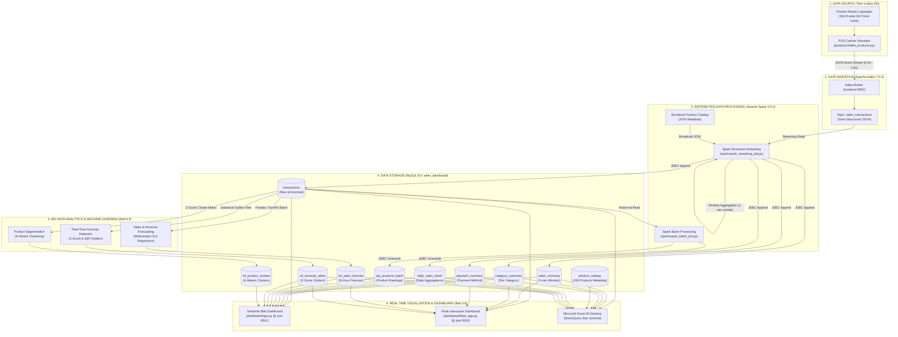
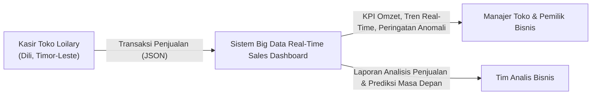
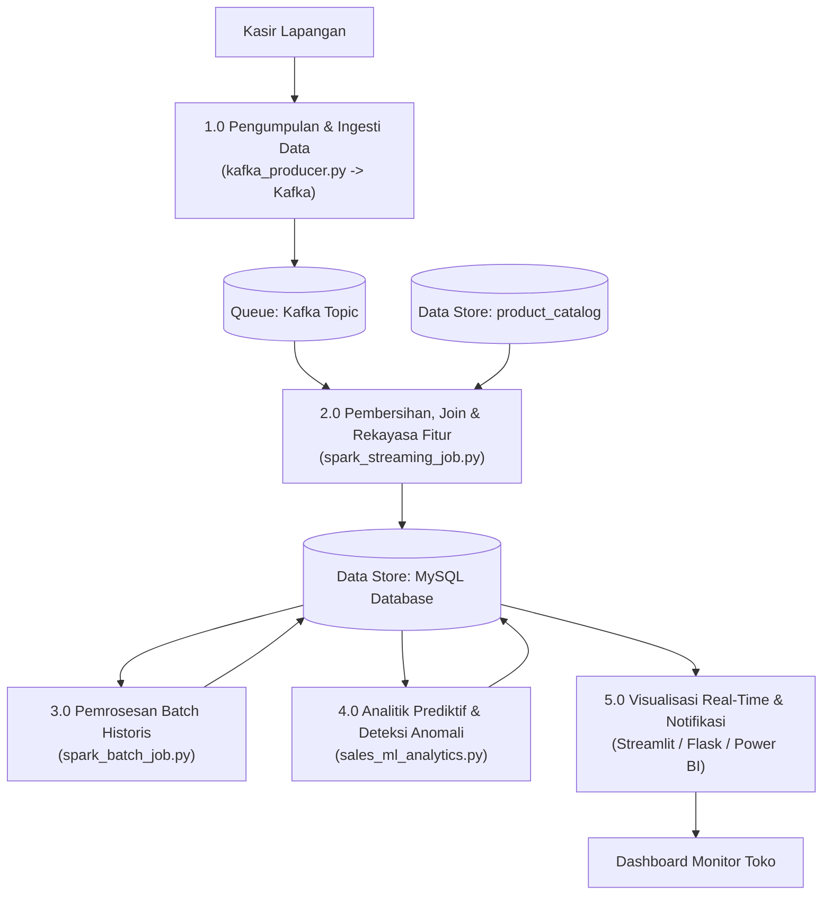

# System Architecture & Data Flow Documentation
**Big Data Capstone Project – S1 Siencia Komputador | DIT 2026**  
**Topik #11:** Real-Time Sales Dashboard (*Monitoring Venda no Revenue*)  
**Studi Kasus:** Toko Loilary Supermarket – Dili, Timor-Leste  

---

## 1. System Architecture Diagram (Bab 7 Manual)

---

## 2. Data Flow Diagram (DFD)

### DFD Level 0 (Context Diagram)

### DFD Level 1 (Proses Terperinci)

---

## 3. Pemetaan Konsep 5V Big Data (Bab 3 Manual)

| Dimensi 5V | Implementasi Nyata pada Proyek Ini |
|---|---|
| **Volume** | Sistem mengelola dataset transaksi berkelanjutan (15.000 transaksi di MySQL, 100% Cash dari data riil Toko Loilary) dan telah lulus uji skalabilitas linier hingga 1.000.000 records. |
| **Velocity** | Data transaksi dihasilkan kasir dan dialirkan ke Kafka setiap 0.5 – 2 detik, diproses dengan Spark Streaming dalam micro-batch window 1 menit. |
| **Variety** | Mengolah format data semi-structured JSON bertingkat (nested store, product, payment) dan ditransformasi menjadi format relational structured schema. |
| **Veracity** | Memastikan keakuratan data melalui validasi skema JSON, filter null/missing values, dan deteksi anomali harga/kuantitas menggunakan Statistical Z-Score dan IQR. |
| **Value** | Mengubah jutaan angka transaksi mentah menjadi metrik bisnis strategis: estimasi margin laba bersih, jam puncak belanja (peak hour), ranking produk terlaris, dan prediksi pendapatan 6 jam ke depan. |
